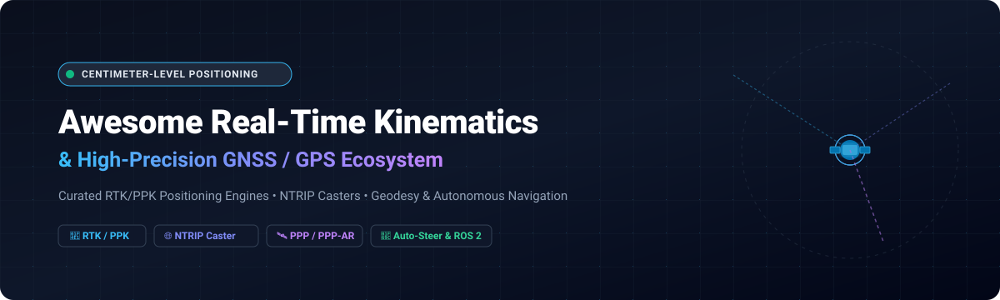

# 🛰️ Awesome Real-Time Kinematics & High-Precision GPS

**A curated list of state-of-the-art SaaS platforms, cloud correction networks, open-source positioning engines, NTRIP casters, and geodesy libraries.**

  
  
  
  
  

---

## 📑 Table of Contents

- [🌐 Sector Overview & Market Dynamics](#-sector-overview--market-dynamics)
- [☁️ SaaS & Hosted Correction Networks](#️-saas--hosted-correction-networks)
- [💻 Open-Source GitHub Projects](#-open-source-github-projects)
- [🤝 How to Contribute](#-how-to-contribute)
- [💖 Support & Sponsorship](#-support--sponsorship)
- [📈 Star History](#-star-history)
- [⚠️ Disclaimer](#️-disclaimer)

---

## 🌐 Sector Overview & Market Dynamics

The global **Real-Time Kinematics (RTK) and high-precision GNSS positioning market** is valued at approximately **$3.34B to $3.61B** (projected to reach over $6B by 2032 with a 7.5%–9.2% CAGR), propelled by rapid adoption across autonomous robotics, precision agriculture, UAV surveying, and autonomous driving. 

The market dynamics exhibit a **moderately fragmented ecosystem transitioning toward strategic concentration**: incumbent geodetic conglomerates (such as Hexagon and Trimble) dominate enterprise survey and high-tier infrastructure through consolidated corrections networks, while specialized venture-backed cloud-NTRIP/PPP-RTK providers (like Point One Navigation and Swift Navigation) together with low-cost multi-band hardware disruptors (such as Emlid and u-blox) rapidly democratize centimeter-level positioning for mass-market autonomy.

---

## ☁️ SaaS & Hosted Correction Networks

*Sorted in descending order by estimated company valuation / annual parent revenue.*

| Platform / Product | Company Size (Valuation / Revenue) | Starting Pricing (Specific Tier) | Free Tier Limits / Free Trial Details | Core Features & Description |
| :--- | :--- | :--- | :--- | :--- |
| **[Leica Zeno Connect & HxGN SmartNet](https://leica-geosystems.com)** | **~$25.6B Market Cap** (~€5.4B Net Sales, Hexagon AB) | ~$100/mo ($2,400/yr billed annually for Statewide NRTK) | **No free tier**; 30-day evaluation trial available upon sales/distributor request | Global Tier-1 CORS network delivering sub-centimeter real-time RTCM3 corrections and PPP satellite services. |
| **[Trimble Catalyst & VRS Now](https://trimble.com)** | **~$18.6B Market Cap** (~$3.68B Revenue, Trimble Inc.) | $14.50/hr (On-Demand 10-hr block at $145) or $60/mo (Catalyst 60 Sub-meter) | **No free tier**; 30-day free trial on selected DA2 hardware bundles with 10 hours complimentary Catalyst 1 cm corrections | Software-defined GNSS positioning service streaming real-time VRS corrections directly to Android/iOS devices. |
| **[Septentrio Cloud & Agnostic Corrections](https://septentrio.com)** | **>€50M Revenue** (Acquired by Hexagon AB, $25.6B Cap) | €59/mo per receiver (starting tier for cloud telemetry & monitoring) | **30-day free trial** for cloud dashboard monitoring (up to 3 connected receivers, full telemetry logging) | Enterprise multi-frequency GNSS tracking, spectrum analysis, and jamming/spoofing resilience monitoring. |
| **[Swift Navigation (Skylark)](https://swiftnav.com)** | **~$450M Valuation** ($251M+ Total Funding) | $29/mo per device (Skylark Standard / sub-meter IoT) or $69/mo (Skylark Nx RTK 1–2 cm) | **14-day free trial** (1 device license, unlimited RTK corrections, no credit card required) | Cloud PPP-RTK network delivering lane-level and centimeter-level accuracy for automotive, UAVs, and robotics. |
| **[Point One Navigation (Polaris RTK)](https://pointonenav.com)** | **~$235M Valuation** ($72.5M Total Funding) | $40/mo (Virtual RTK / 10 cm accuracy) or $85/mo (True RTK / 1–3 cm accuracy) | **14-day free trial** (full access to True RTK & Virtual RTK on 1 active device, no credit card required) | High-density continental RTK correction network with standard NTRIP API integration and instant ambiguity resolution. |
| **[Emlid Reach Cloud & Caster](https://emlid.com)** | **~$25M–$50M Revenue** (Privately held / bootstrapped) | $15/mo per user (ReachView 3 Survey Surveying Pro) | **Free forever plan**: Emlid Caster includes up to 5 base stations and 10 rovers connected simultaneously | Cloud NTRIP correction caster and geodetic survey project synchronization engine for Reach GNSS receivers. |
| **[Bad Elf Cloud & Flex Tokens](https://bad-elf.com)** | **~$5M–$15M Revenue** (Privately held SMB) | $25 per daily token (24-hour full RTK unlock) or $240/yr Base Subscription | **Free forever tier**: Sub-meter SBAS field mapping in Bad Elf app; includes 5 free trial 24-hr RTK tokens with hardware | Hybrid token-based field GNSS platform allowing pay-as-you-go centimeter RTK unlocking on demand. |
| **[EOS Positioning Systems (Tools Pro)](https://eos-gnss.com)** | **~$5M–$15M Revenue** (Privately held SMB) | $0 (Free companion utility app for Arrow hardware; external RTK corrections separate) | **Free forever utility**: 100% free app without feature gating; free NTRIP client connection to public/state CORS | Mobile GNSS monitoring, laser offset mapping, orthometric height transformations, and NTRIP bridge for Arrow receivers. |
| **[Tersus GNSS (Tersus Caster Service)](https://tersus-gnss.com)** | **~$10M–$20M Revenue** (Privately held) | Free with Tersus hardware; $35/mo for standalone cloud NTRIP caster instances | **Free forever tier**: Unlimited base-to-rover RTCM relay when using Tersus Oscar/Luka hardware | Cloud NTRIP caster infrastructure and survey telemetry relay designed for land surveying and drone missions. |

---

## 💻 Open-Source GitHub Projects

*Sorted in descending order by GitHub stargazers count.*

- **[ArduPilot](https://github.com/ArduPilot/ardupilot)**   
  🚁 Leading open-source autopilot software for autonomous drones, rovers, and boats with native multi-frequency RTK GNSS injection, moving baseline yaw calculation, and compass-less heading.

- **[PX4 Autopilot](https://github.com/PX4/PX4-Autopilot)**   
  🛩️ Open-source flight stack powering commercial drones and robotics, featuring RTCM 3.x correction forwarding over MAVLink and dual-receiver RTK heading.

- **[GTSAM](https://github.com/borglab/gtsam)**   
  📐 High-performance C++ factor graph optimization library widely adopted for tightly coupled RTK-GNSS, IMU pre-integration, LiDAR odometry, and SLAM in robotics.

- **[tomojitakasu/RTKLIB](https://github.com/tomojitakasu/RTKLIB)**   
  🛰️ The foundational open-source GNSS positioning engine for standard and precise positioning (RTK, PPK, PPP) supporting GPS, GLONASS, Galileo, BeiDou, QZSS, and SBAS.

- **[GPSTest](https://github.com/barbeau/gpstest)**   
  📱 Premier open-source Android GNSS/GPS utility showing real-time dual-frequency carrier signals (L1/L5), carrier-to-noise ratio ($C/N_0$), and satellite skyplots.

- **[GNSS-SDR](https://github.com/gnss-sdr/gnss-sdr)**   
  📡 Open-source software-defined receiver for multi-frequency satellite navigation systems, converting RF baseband samples into observable pseudoranges and PVT solutions.

- **[Aceinna gnss-ins-sim](https://github.com/Aceinna/gnss-ins-sim)**   
  🧪 Python-based GNSS/INS simulation toolkit for modeling multi-frequency GPS/RTK receivers, IMU sensor noise profiles, odometry errors, and navigation filter verification.

- **[KF-GINS](https://github.com/i2Nav-WHU/KF-GINS)**   
  🔄 Extended Kalman Filter (EKF)-based GNSS/INS integrated navigation system delivering centimeter-accurate trajectory solving with carrier phase differential RTK coupling.

- **[GVINS](https://github.com/HKUST-Aerial-Robotics/GVINS)**   
  👀 Tightly coupled GNSS-Visual-Inertial fusion framework developed by HKUST for drift-free 6-DoF state estimation in GNSS-degraded or urban canyon environments.

- **[RTKLIB Explorer (demo5)](https://github.com/rtklibexplorer/RTKLIB)**   
  ⚡ Actively maintained fork of RTKLIB fine-tuned for low-cost multi-band receivers (u-blox ZED-F9P, Unicore UM980) with accelerated integer ambiguity resolution.

- **[AgOpenGPS](https://github.com/AgOpenGPS-Official/AgOpenGPS)**   
  🚜 World-renowned open-source precision agriculture system for automatic tractor steering, section control, and field contouring using dual-antenna RTK GPS.

- **[rtkbase](https://github.com/Stefal/rtkbase)**   
  🍓 Open-source ready-to-run web GUI and service stack converting a Raspberry Pi and GNSS board into a permanent, self-hosted NTRIP base station and RTK caster.

- **[Pocket SDR](https://github.com/tomojitakasu/PocketSDR)**   
  📻 Lightweight open-source SDR toolchain for tracking multi-band GNSS signals (GPS, GLONASS, Galileo, BeiDou, QZSS, NavIC) written by Tomoji Takasu.

- **[KumarRobotics ublox](https://github.com/KumarRobotics/ublox)**   
  🤖 Battle-tested ROS driver for u-blox GNSS devices supporting RTCM3 injection, high-rate navigation, and rover-base communication pipelines.

- **[Ginan](https://github.com/GeoscienceAustralia/ginan)**   
  🌏 Australian Government Geoscience Australia’s open-source Precise Point Positioning (PPP) and Network Analysis Center software generating real-time satellite orbit and clock corrections.

- **[FAST-LIVO2-RTK](https://github.com/xuankuzcr/FAST-LIVO2-RTK)**   
  🚀 Fast LiDAR-Inertial-Visual odometry system tightly integrated with RTK-GNSS global factor graph optimization for large-scale centimeter-accurate mapping.

- **[pyubx2](https://github.com/semuconsulting/pyubx2)**   
  🐍 Comprehensive Python parser, serializer, and generator for u-blox UBX protocol messages, facilitating telemetry collection and high-precision receiver scripting.

- **[ybzwyrcld/ntrip](https://github.com/ybzwyrcld/ntrip)**   
  🌐 Robust, lightweight open-source C/C++ NTRIP 1.0/2.0 caster server for distributing RTCM correction streams across base stations and rovers.

- **[pygnssutils](https://github.com/semuconsulting/pygnssutils)**   
  🛠️ Python command-line utility suite for managing GNSS hardware, streaming NTRIP RTCM corrections, converting RINEX logs, and recording geodetic traces.

- **[pyrtcm](https://github.com/semuconsulting/pyrtcm)**   
  📦 Pure Python parser and generator for RTCM3 (Radio Technical Commission for Maritime Services) differential correction messages used in RTK/PPK setups.

- **[ublox_dgnss (ROS 2)](https://github.com/aussierobots/ublox_dgnss)**   
  🏎️ Modern ROS 2 driver for u-blox F9P/F9R multi-band receivers supporting RTCM correction injection, moving base relative heading, and high-precision position fixes.

- **[libsbp (Swift Binary Protocol)](https://github.com/swift-nav/libsbp)**   
  🛰️ Fast, open-source serialization library for Swift Navigation's binary messaging protocol, handling GNSS observations, corrections, and telemetry.

---

## 🤝 How to Contribute

Contributions are welcome and greatly appreciated! Help us keep this high-precision positioning resource comprehensive and up-to-date:

1. 🍴 Fork the repository.
2. 🌿 Create your feature branch (`git checkout -b feature/amazing-rtk-tool`).
3. ✏️ Add or update entries following the table format for SaaS or list format for Open-Source (ensure you link to official project repositories).
4. 💾 Commit your changes (`git commit -m 'Add new RTK GNSS engine'`).
5. 🚀 Push to the branch (`git push origin feature/amazing-rtk-tool`).
6. 📬 Open a Pull Request with a clear description of the project.

---

## 💖 Support & Sponsorship

If you find this repository valuable for your research, surveying workflows, robotics stack, or precision agriculture setups:

- ⭐ **Star this repository** to help others discover it!
- 🍴 **Fork and share** it with your fellow geodesists, UAV engineers, and robotics builders.
- ☕ **Support the maintainer**: Buy a coffee and support continuous updates via the **[GitHub Sponsor Dashboard](https://github.com/sponsors/ishandutta2007)**!

---

## 📈 Star History

---

## ⚠️ Disclaimer

- This is a community-curated list for informational and educational purposes. Mention of commercial products or open-source libraries does not constitute an endorsement.
- High-precision surveying and autonomous vehicle navigation require proper geodetic datum transformations (e.g., WGS84/ITRF to national local geodetic reference systems), antenna phase center calibrations (ANTEX), and multipath mitigation.
- Radio telemetry frequencies (UHF, LoRa) utilized for base-to-rover RTK transmission must strictly adhere to regional wireless communications regulations (e.g., FCC, CE/RED, WPC).
